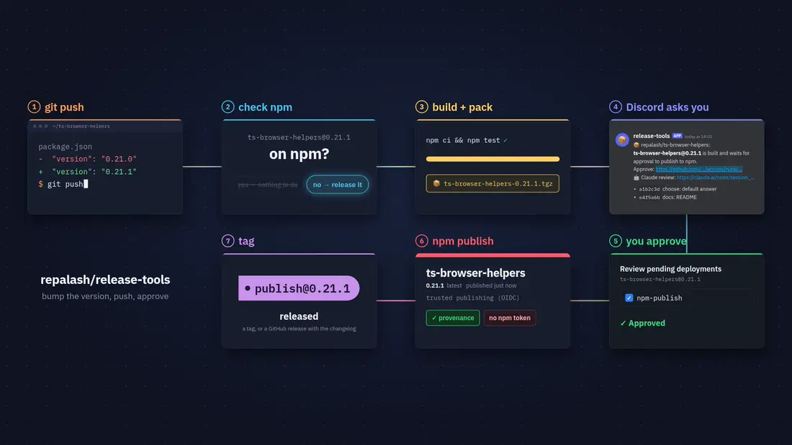
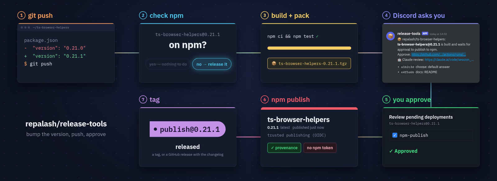

# release-tools

Bump the version and push. You get a Discord message, you approve, and the package is on npm with provenance. No npm token is stored anywhere.



- **Version-driven**: a package is released when its `version` is not on npm yet. Any other push stops after the check.
- **Approval first**: publishing waits for you on the `npm-publish` environment, and publishes the tarballs that were built and checked before.
- **No npm tokens**: npm trusted publishing (OIDC), with a provenance statement for each version.
- **One package or a monorepo**: a root package, a subfolder, or all npm workspaces in dependency order.
- **Release notes**: the `CHANGELOG.md` section of the version becomes the GitHub release.

## The flow



A version that is already on npm ends the run after the check. A failed check, build or pack posts a ❌ notice instead, and nothing is published.

## Discord notice

A release that waits for approval, or that fails, posts a message to your channel:

> 📦 repalash/ts-browser-helpers: **ts-browser-helpers@0.21.1** is built and waits for approval to publish to npm.<br>
> Approve: https://github.com/repalash/ts-browser-helpers/actions/runs/…<br>
> 🤖 Claude review: https://claude.ai/code/session_…<br>
> <br>
> \- `a1b2c3d` choose: default answer<br>
> \- `e4f5a6b` docs: README

> ❌ repalash/ts-browser-helpers: the check, build or pack of **ts-browser-helpers@0.21.1** failed; nothing is published.<br>
> Log: https://github.com/repalash/ts-browser-helpers/actions/runs/…<br>
> \- ts-browser-helpers@0.21.1: no CHANGELOG.md section

The list shows the commits since the previous release of the package. The Claude review line appears when a Claude Code routine is set up: the workflow starts a session that reviews the release while it waits for you.

## Quick start

1. Add the workflow, `.github/workflows/publish.yml`:

   ```yaml
   name: Publish to npm
   on:
     push:
       branches: [master]
     workflow_dispatch:
   permissions:
     contents: read
   concurrency:
     group: publish
     cancel-in-progress: false # never cancel a publish half-way
   jobs:
     release:
       permissions:
         contents: write # tags and GitHub releases
         id-token: write # npm trusted publishing
       uses: repalash/release-tools/.github/workflows/npm-release.yml@v1
       with:
         build: npm ci && npm test
       secrets: inherit
   ```

2. Set up the repository once, before the first push: the `npm-publish` environment with you as required reviewer, the Discord and Claude secrets, and the npm trusted publisher. From a clone of this repository, one command does all three and is safe to run again:

   ```sh
   scripts/setup-repos.sh <owner>/<repo>:publish.yml:<npm-package>
   ```

3. Release: bump `version` in `package.json`, push, and open the link in Discord.

More callers (a package in a subfolder, workspaces, GitHub releases): [`examples/`](examples).

## Configuration

| Input | Default | |
|---|---|---|
| `packages` | `.` | Package directory, or `<dir>/*` for every package below it. Several: separate with spaces. |
| `build` | `npm ci` | Command run before packing. Empty: no build. |
| `node-version` | `24` | Node.js for the build. |
| `clean-package` | `false` | Pack with the package's [clean-package](https://www.npmjs.com/package/clean-package). |
| `require-changelog` | `false` | Fail when the version has no `CHANGELOG.md` section. |
| `tag-format` | `publish@{version}` | `{name}-{version}` when there are several packages. |
| `github-release` | `false` | A GitHub release with the tarball instead of a plain tag. |
| `review-actor` | `repalash` | Only pushes by this user start the Claude review. |

| Secret (optional) | |
|---|---|
| `DISCORD_WEBHOOK_URL` | Channel webhook for the notice. |
| `CLAUDE_REVIEW_FIRE_URL`, `CLAUDE_REVIEW_TOKEN` | Fire URL and token of the Claude Code routine. |

To rotate one secret in several repositories: `scripts/setup-repos.sh --set-secret CLAUDE_REVIEW_TOKEN <owner>/<repo> ...`

<details>
<summary><b>Details</b>: tags, changelog, prereleases, setup by hand, security</summary>

### Tags and changelog

- With a `/*` entry or several entries in `packages`, the tag format must contain `{name}`. The previous release is the latest tag in that format reachable from the commit. For a format without `{name}`, `v1.2.3` tags also count.
- A CHANGELOG section starts at a heading (`#` to `###`) whose first word is the version: `## [1.2.3] - 2026-01-01`, `## v1.2.3`, `# [1.2.3](link) (date)`. An empty section counts as missing.
- A prerelease (`1.0.0-beta.1`) gets the dist-tag `next`, unless `publishConfig.tag` sets another one, and a prerelease GitHub release.
- In workspaces, private packages are skipped, and `build` must build every package that the released ones need.
- Output: `release`, the JSON of the release (`packages` is empty when nothing was pending).

### Setup by hand

1. Create the environment `npm-publish` with you as required reviewer: `https://github.com/<owner>/<repo>/settings/environments`. Do it before the first run: GitHub creates a missing environment without protection, so the check job stops when `npm-publish` has no required reviewer.
2. Optional: add the secrets at `https://github.com/<owner>/<repo>/settings/secrets/actions`.
3. Add a trusted publisher at `https://www.npmjs.com/package/<name>/access`: GitHub Actions, `<owner>`, `<repo>`, the file name of the **calling** workflow (for example `publish.yml`, not `npm-release.yml`), environment `npm-publish`.

The calling job must grant `contents: write` and `id-token: write`: a called workflow cannot get more permissions than its caller. With `cancel-in-progress: false`, runs queue: a newer run waits until the one before it is approved, rejected or cancelled. The tarballs are kept for 14 days, the window for the approval. A publish job can run again: a version that is on npm is not published again, and an existing tag on the same commit is kept.

### Security

- The check job runs your build with no secrets and a read-only token, and stops when `npm-publish` has no required reviewer.
- The notify job holds the secrets and runs only the scripts of this repository, never your code.
- The publish job runs only the scripts of this repository and publishes the checked tarballs with `npm publish --ignore-scripts`.
- Pin callers to a tag (`@v1`) or a commit SHA. The jobs check out these scripts at the commit of the called workflow (`job.workflow_repository`, `job.workflow_sha`), so the workflow and its scripts always match. These contexts are not available on GitHub Enterprise Server.

### Development

`npm install && npm test`. [actionlint](https://github.com/rhysd/actionlint) checks the workflows; `.github/actionlint.yaml` ignores its messages about `job.workflow_repository` and `job.workflow_sha`, which version 1.7.12 does not know yet. The scripts also run locally: `npm run release:check -- --root ../my-repo --packages 'packages/*'`.

</details>

## Also in this repository

[`dts-js-extensions`](packages/dts-js-extensions): rewrites relative imports in emitted `.d.ts` files to explicit `.js` paths, for `moduleResolution: node16 | nodenext`.

Used by [ts-browser-helpers](https://github.com/repalash/ts-browser-helpers), [uiconfig.js](https://github.com/repalash/uiconfig.js), [three-ts-types](https://github.com/repalash/three-ts-types), [three.js-modded](https://github.com/repalash/three.js-modded) and [tweakpane-image-plugin](https://github.com/repalash/tweakpane-image-plugin).

## License

MIT
